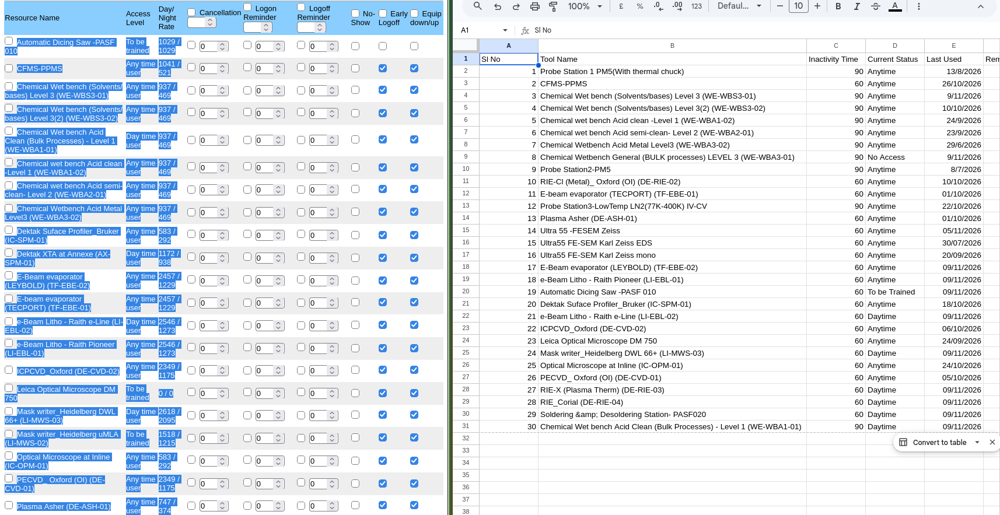

# STEPS TO USE AUTOLOGGER

## STEP 1: Setting up FOM Calendar on Google

1. Open My Profile after logging on to FOM.
2. Choose the google account you will be using for maintaining your FOM calendar by choosing the "link to google calendar" radio button.


## STEP 2: Setting up Base Logger Sheet

1. Open the google sheets using the google account you have linked the FOM calendar to and upload the excel sheet provided in the git repository.

2. On my profile in FOM scroll down to see the tools you have access to and make modifications to the column name titled tools. You can copy paste directly to the excel sheet from FOM. But make sure to paste only values and not the formatting.




3. The Tool Name corresponds to the exact tool name that is shown on FOM.

4. The inactivity time is something you will have to set, it will depend on your requirement(or in how many ever days the tool expires).

5. The last used parameter will only be tracked for the tools which "Current State" is set to Any Time User. The other tools will show the date when the script was run last. This field will have to manually adjusted once, or will updated once the slot has been completed.

6. The reminder days is the number of days before the tool expiry, you would like to receive the reminder email.

7. The category is an optional field, some tools seem to have correlated expiry date, so one can assign them the same category as seen in the provided sheet, or simply left blank if its inapplicable.

## STEP 3: Setting up Apps Script

1. On the google sheet, select the menu "Extensions" -> "Apps Script"
2. On the editor copy paste the contents of "script.txt" to the editor and save.
3. Select the option "Triggers" (found on the left side icon which looks like an alarm clock). Click on "Add Trigger" and set up as seen in the image and save.


4. Google will ask you to give authorisation, please authorise the access.

5. Now come back to editor and edit the variables :
```
  const CALENDAR_ID = '<calendar ID>';
  const NOTIFICATION_EMAIL = '<notification email>';

```

Make sure to use two different emails for this case.

- The calendar ID is usually the email ID which is linked to the FOM account. Go to the calendar that FOM is marking slots on, and check the "calendar ID" of the calendar.
- The Notification email can be any email you want to notify.

## STEP 4: SETTING UP EMAIL NOTIFICATIONS (OPTIONAL)

**THIS STEP IS ONLY REQUIRED IF EMAILS SENT BY THE SCRIPT ARE GETTING BLOCKED**

Go to email and set up a filter as follows:


Click on continue and:


Save.
