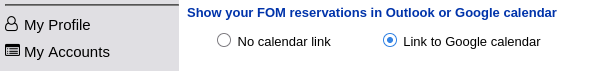
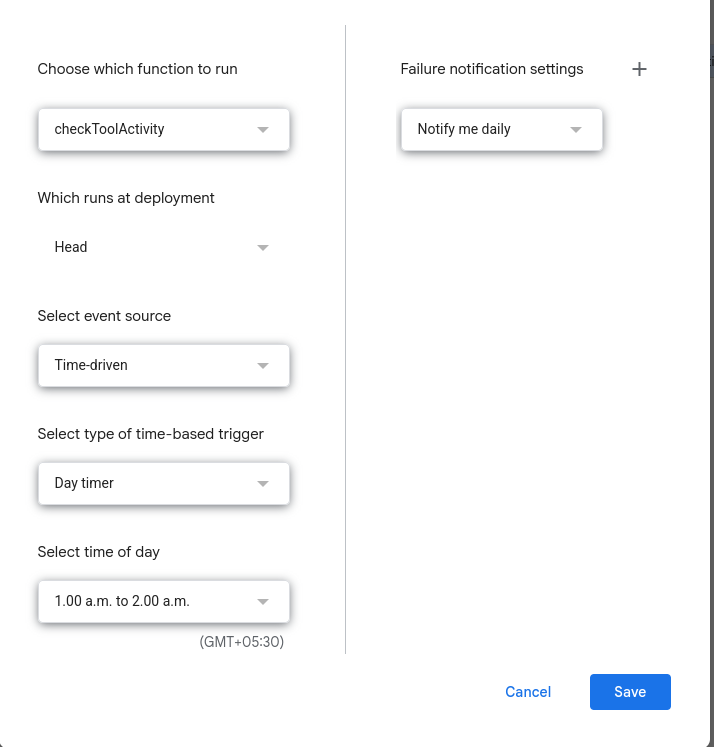
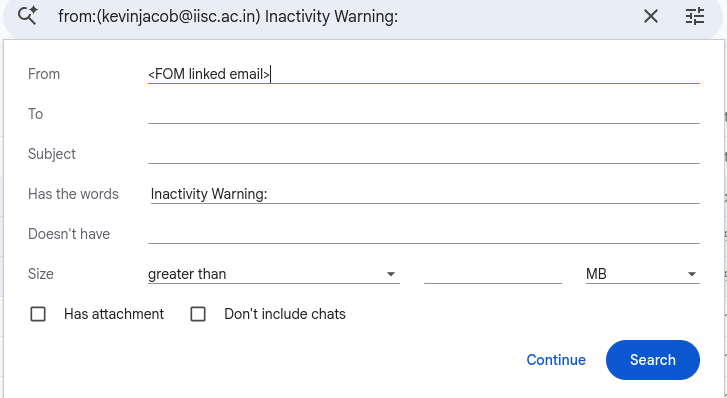
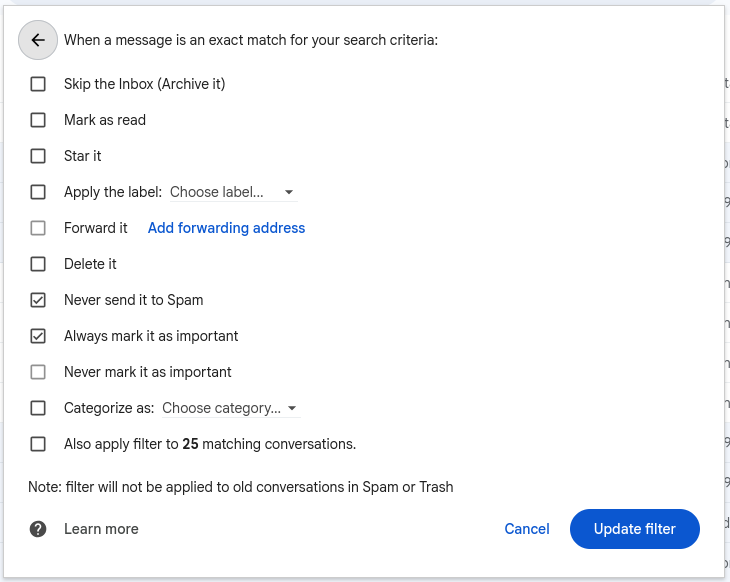

# STEPS TO USE AUTOLOGGER

## STEP 1: Setting up FOM Calendar on Google

1. Open My Profile after logging on to FOM.
2. Choose the google account you will be using for maintaining your FOM calendar by choosing the "link to google calendar" radio button.


## STEP 2: Setting up Base Logger Sheet

1. Open the google sheets using the google account you have linked the FOM calendar to and upload the excel sheet in the tool repo.

2. On my profile in FOM scroll down to see the tools you have access to and make modifications to the column name titled tools.

## STEP 3: Setting up Apps Script

1. On the google sheet, select the menu "Extensions" -> "Apps Script"
2. On the editor copy paste the contents of "script.txt" to the editor and save.
3. Select the option "Triggers" (found on the left side icon which looks like an alarm clock). Click on add trigger and set up as seen in the image and save.



4. Now come back to editor and edit the variables :
```
  const CALENDAR_ID = '<calendar ID>';
  const NOTIFICATION_EMAIL = '<notification email>';

```

Make sure to use two different emails for this case.

- The calendar ID has to be email ID which is linked to the FOM account.
- The Notification email can be any email you want to notify.

## STEP 4: SETTING UP EMAIL NOTIFICATIONS

Go to email and set up a filter as follows:


Click on continue and:


Save.
